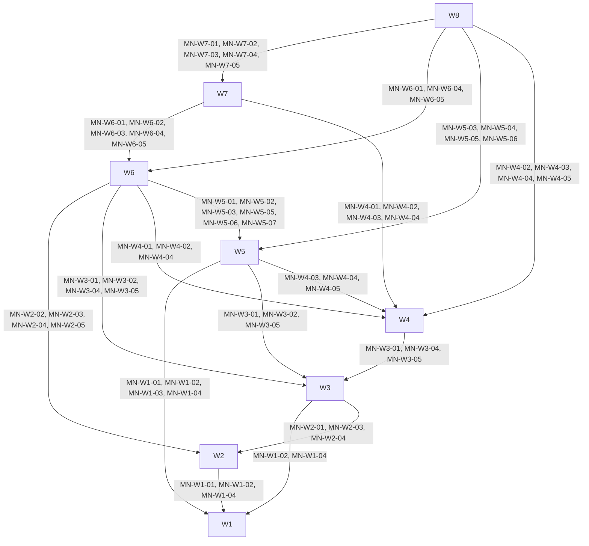

<!-- aligned-structure:v2 -->
# Mission-native MCP Planning Composition

## Motivation

Replace manual new-run transcript-folder scaffolding and lifecycle scripts with
Session-owned input and Mission-owned MCP planning. A requester approves the exact
plan revision before execution. This parent owns composition only, not child criteria.

## Reading Order

1. [Mission Domain](../38a8ea3a-9a6a-4a0f-bc5a-97dc9ba670fc/body.md) — unchanged domain authority.
2. [Source roadmap](../../../../../transcripts/29-10-2026_mission-native-mcp-planning/ROADMAP.md) — route and validation.
3. [Requester inputs](../../../../../transcripts/29-10-2026_mission-native-mcp-planning/inputs/merged.clean.md) — source decisions.

Direct children:

1. [W1 Shared Lifecycle Projections and Waypoint Capabilities](../908e1755-d486-4e49-8b63-3f9eee81396e/body.md)
2. [W2 Session Input Intake and Managed Mission Workspace](../8f53aa05-fb9c-4fec-9458-1eeb55b7342e/body.md)
3. [W3 Granular Mission Plan Mutation and Coherent Projection](../c3385d21-983e-4fb5-92f7-2a6ad757677a/body.md)
4. [W4 Requester Decision Authority and Revision-bound Execution Grant](../9fe60c69-af53-4578-9310-69283cd09284/body.md)
5. [W5 Mission Lifecycle, Session Handoff and Audited Ticket Reopen](../164e9acd-9781-4455-b835-f7121a275eef/body.md)
6. [W6 Discoverable Mission-native MCP Tool Contracts](../551422d7-8a0f-4711-8642-a4c367649361/body.md)
7. [W7 Mission-native New-run Workflow Routing and Guidance](../ec2f0709-180f-4ccf-b692-601796f33e05/body.md)
8. [W8 Installed MCP Native Planning Acceptance and Requester Walkthrough](../361a2900-65d1-41c4-9b28-9de7842b42f4/body.md)

## Component Relationship Map

Edges point consumer -> provider -> named provider criteria. Every W1-W8 component
sets this root as parent. Child internals and acceptance remain exclusively in those
children. Existing approved provider Specs retain identity, state and historical parent.

## Shared Invariants

Mission owns Mission state and generated projections; Session owns submitted input;
Ticket owns linked Ticket state/history. Shared lifecycle/capability types do not
become a generic store. Stable identities, explicit roots, CAS, immutable evidence
and retry journals preserve domain boundaries. Machine validation is not requester
authority. Semantic replans require fresh exact-revision review and approval.

## Examples

Intake provides immutable input/workspace identity to plan operations; approval
consumes their plan identity; lifecycle consumes approval and Ticket authority;
named MCP exposes those services; routing and installed acceptance consume that surface.

## Scope

Composition only. No component-internal criteria, execution, Mission publication,
archive migration or passing validation claim. No root-owned ValidationSpec is
necessary; concrete child guards are planned, not registered or run in planning.
