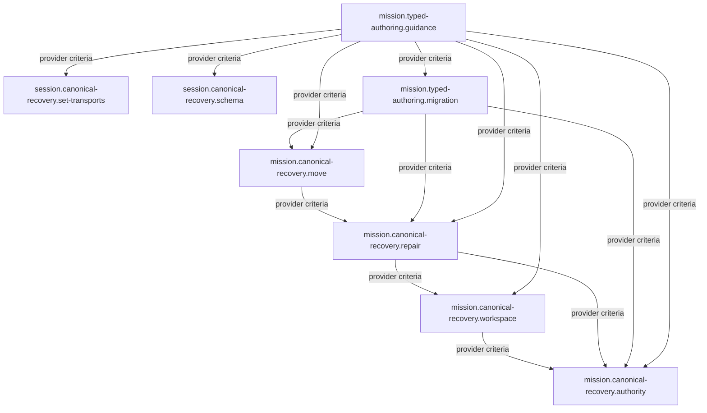

<!-- aligned-structure:v2 -->
# Canonical Mission Recovery and Session Integration

## Motivation
Recover one canonical Mission authority, preserve known damaged migration evidence, and integrate Session's missing domain surfaces without inventing production schemas. This composition links historical owners; it does not claim their completed work already satisfies corrective contracts.

## Reading Order
1. [Historical typed-authoring composition](../dee92faf-b649-4577-8016-e6e465e6724a/body.md)
2. [Reviewed implementation route](../../../../../transcripts/24-10-2026_mission-typed-authoring/ROADMAP.md)
3. [Correct persisted typed Mission lifecycle authority](../0a8b3ea4-a3ce-4f26-90cc-1ce34474fb6c/body.md)
4. [Portable explicit and configured Mission launch roots](../eb4444fd-1349-471f-b911-26b8c7cdf5d0/body.md)
5. [Journaled forward Mission repair with durable recovery](../44f100c4-215e-445a-b452-1a8a969d96cc/body.md)
6. [Shared-kernel Mission set relocation and recovery](../2cd4db32-3987-4d6f-a2dc-774c356b69ad/body.md)
7. [Session set-move CLI and MCP transport parity](../af04e1d2-0a89-4720-b03e-ec1c23c53235/body.md)
8. [Session schema migration lifecycle infrastructure at production v1](../cef24f88-a24b-4d1c-9a9c-5c249e9991f9/body.md)
9. [Execute bounded live Mission repair and canonical relocation](../53e78fcb-df6f-4d74-91fa-163dbcb0e1a8/body.md)
10. [Canonical Mission and Session operational guidance](../a404c898-c859-485d-99c0-0bc539312477/body.md)

## Component Relationship Map

The six new direct children own W1-W6. Existing migration/guidance specs retain their historical parent and are linked external contract owners; they are not duplicate child contracts.

## Shared Invariants
API-owned identity/content/CAS/lifecycle, immutable historical evidence, explicit roots, transport parity, and planned-versus-actual journal identity remain distinct. Production Session schema stays v1. No internal Copilot storage is source context. Domain operations and read-back are mandatory.
The requester-selected W1-W3 dossier bootstrap requires final execution approval; the same existing Mission is separately repaired/read back/rebound/published before native W4-W9. Live W7 operations require exact-set approval and move the execution Mission last. No duplicate authority is created.

## Examples
Repair provides verified current state to move; neither is implemented by its transport. Session adapters consume their existing API independently of Mission code. Migration consumes repaired authority plus repair/move providers, while guidance consumes the verified delivered contracts.

## Scope
Composition only. Component criteria, concrete validations and owning execution entities live in the linked child or reused owner specs, not duplicated here. No implementation or verified-state claim.
