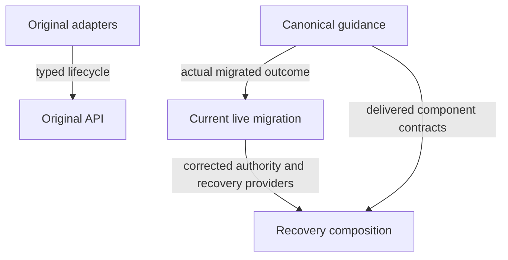

<!-- aligned-structure:v2 -->
# Typed file-backed Mission authoring composition

## Motivation

Mission API owns structured typed authoring, UUID/bootstrap, revision/CAS and
lifecycle; clients author typed source and independent Part data, while
Markdown is generated output. Original completed authoring work remains
historical evidence, not proof that corrective recovery is implemented.

The current recovery refinement replaces the former all-store/internal-pilot
migration boundary with five named repository-local identities and three
canonical relocations. It preserves completed waypoint identities/results,
immutable historical evidence and explicit live authorization. The focused
recovery composition below owns these additions and Session integration;
this historical composition does not duplicate their criteria.

## Reading Order

1. [Original API lifecycle owner](../9fd527d8-e290-44e3-9edb-9f7d6658551a/body.md).
2. [Original transport owner](../9413a0a2-0d53-407d-b088-3953074393fb/body.md).
3. [Current recovery composition](../9f8d9f34-764f-4821-9b14-b6d8773ec2ae/body.md).
4. [Revised live migration owner](../53e78fcb-df6f-4d74-91fa-163dbcb0e1a8/body.md).
5. [Revised canonical guidance owner](../a404c898-c859-485d-99c0-0bc539312477/body.md).

## Component Relationship Map

The original four children retain their parent and stable spec identity.
The recovery root is linked additional composition, not a duplicate API owner
or an implied prerequisite outside the reviewed recovery route.

## Shared Invariants

Transport thinness, one API-owned source, independent prompt/Part meaning,
valid incomplete save versus publication readiness, immutable history, external
ownership and generated output remain binding. Current live scope and
bootstrap/native label mapping are defined by the linked corrective contracts;
old all-store/pilot selection and repeated final-suite requirements are no
longer effective planning instructions.

## Examples

A corrected author creates/saves typed content through API, publishes only
ready content and reads generated Markdown. The existing execution Mission
retains its old completed identities while the recovery route is rebound,
then moves once to the canonical Mission workspace after exact-set approval.

## Scope

Shared composition only. Component acceptance criteria and measurable evidence
remain owned by child or linked corrective specs. The spec is approved
planning content, not an implemented/verified or live-operation claim.
